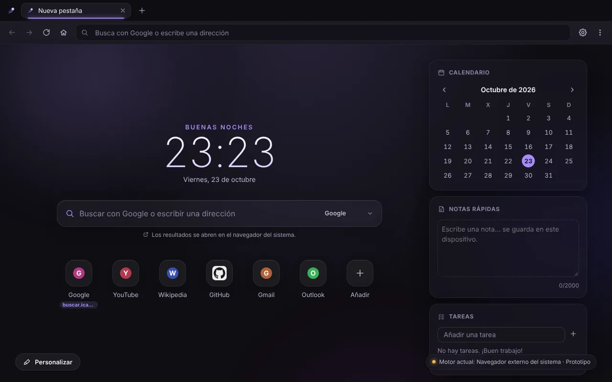
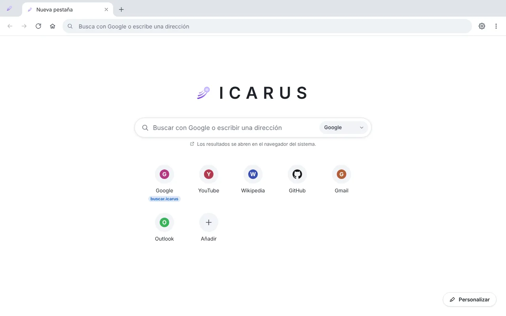
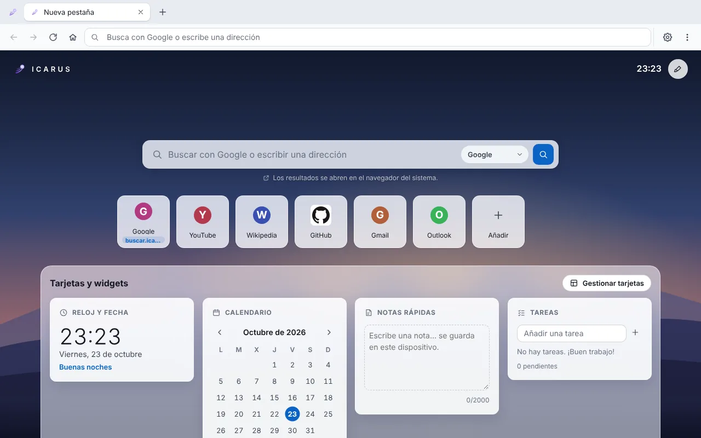
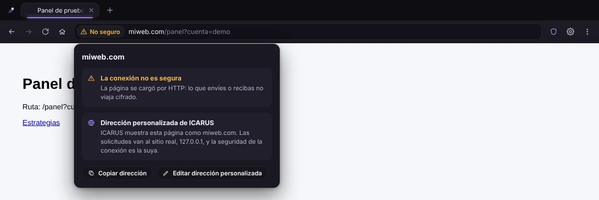
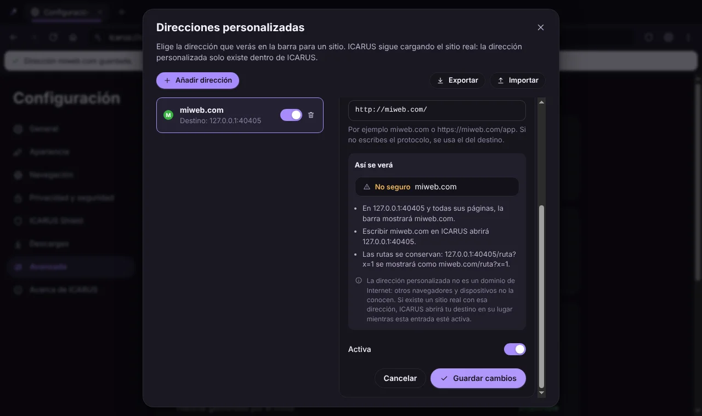
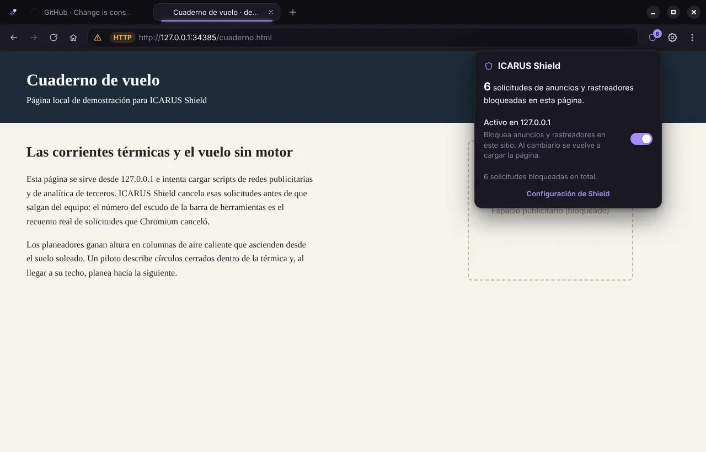
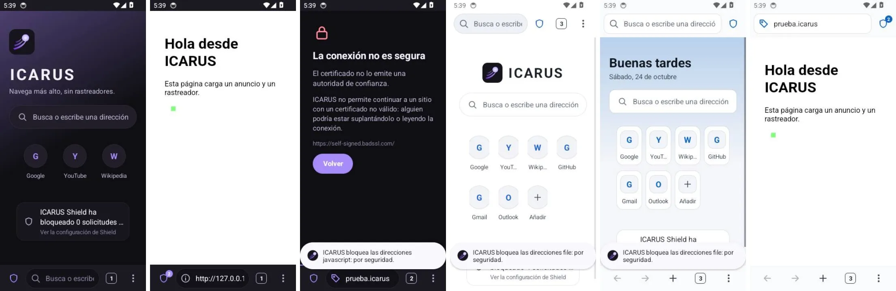
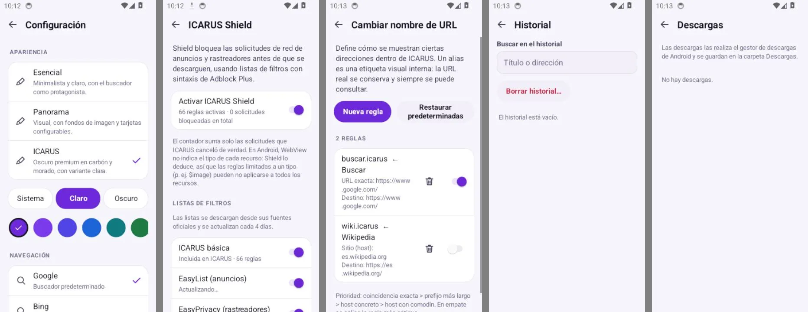
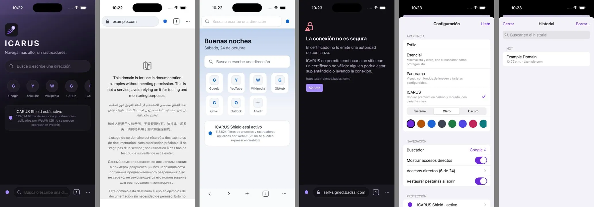

# ICARUS Browser

Navegador web con identidad propia, interfaz personalizable, bloqueador de anuncios y rastreadores (ICARUS Shield) y direcciones personalizadas en la barra (por ejemplo, ver `miweb.com` mientras navegas por `bot.deriv.me`), para Windows, macOS, Android, iPhone y iPad.

**Versión 0.2.0 (preliminar).** Cada plataforma tiene su propio paquete; ninguno sirve para otra:

| Plataforma | Motor | Paquete |
| --- | --- | --- |
| Windows 10/11 x64 | Chromium 152 (Electron 44) | Instalador NSIS `.exe` y `.zip` portátil |
| macOS 12 o posterior (Apple Silicon e Intel) | Chromium 152 (Electron 44) | `.dmg` y `.zip` con firma ad hoc |
| Android 10 o posterior | WebView del sistema (Chromium, actualizado por Google Play) | `.apk` |
| iPhone y iPad con iOS 16 o posterior | WebKit (el motor que iOS exige) | `.ipa` sin firmar |

En escritorio cada pestaña es una vista real de Chromium que carga las páginas dentro de la ventana de ICARUS; la interfaz (tres estilos, personalización, accesos directos, widgets, configuración y «Personalizar direcciones URL») controla el motor real. Las apps de Android e iPhone son proyectos aparte (`mobile/android`, `mobile/ios`) con interfaz nativa, pero reutilizan la lógica de escritorio: direcciones personalizadas, interpretación y formato de la barra de direcciones, Public Suffix List, filtros de Shield, colores de los estilos y textos se generan desde el código de escritorio en `mobile/shared` y las tres plataformas se prueban con los mismos vectores. Ver [Android, iPhone y iPad](#android-iphone-y-ipad).

El prototipo web (`dist/icarus-browser.html`) sigue existiendo, pero **no es un navegador ni un instalador**: es solo la interfaz, que entrega las páginas al navegador del sistema. Ver [Versión web](#versión-web-prototipo).

> ICARUS no está afiliado a Google ni a Microsoft. Los estilos «Esencial» y «Panorama» son diseños originales inspirados en patrones de navegadores conocidos; no usan logotipos ni recursos de esas marcas.

| ICARUS (estilo propio) | Esencial (inspirado en Chrome) | Panorama (inspirado en Edge) |
| --- | --- | --- |
|  |  |  |

| La barra muestra solo la dirección personalizada; la información del sitio dice quién recibe las solicitudes | Editor «Direcciones personalizadas» (Configuración → Avanzado) |
| --- | --- |
|  |  |

<sub>Aplicación de escritorio con Electron real: una página local por HTTP (`127.0.0.1`) se muestra como `miweb.com/panel?cuenta=demo`. Como la conexión real es HTTP, la barra dice «No seguro»: la dirección personalizada no cambia el estado de seguridad. Las capturas de la nueva pestaña son comunes a escritorio y al prototipo web.</sub>



<sub>Aplicación de escritorio: una página local que pide scripts e imágenes a redes publicitarias y de analítica. El escudo muestra las 6 solicitudes que Chromium canceló de verdad.</sub>

---

## Índice

- [Estado de esta versión](#estado-de-esta-versión)
- [Instalar en Windows](#instalar-en-windows)
- [Instalar en macOS](#instalar-en-macos)
- [Instalar en Android](#instalar-en-android)
- [Instalar en iPhone y iPad](#instalar-en-iphone-y-ipad)
- [Compilar desde el código](#compilar-desde-el-código)
- [Funciones del navegador](#funciones-del-navegador)
- [Interfaz y personalización](#interfaz-y-personalización)
- [Android, iPhone y iPad](#android-iphone-y-ipad)
- [Versión web (prototipo)](#versión-web-prototipo)
- [Limitaciones conocidas](#limitaciones-conocidas)
- [Estructura del código](#estructura-del-código)
- [Datos y persistencia](#datos-y-persistencia)
- [Seguridad](#seguridad)
- [Pruebas](#pruebas)
- [Integración continua y publicación](#integración-continua-y-publicación)
- [Licencias de terceros](#licencias-de-terceros)
- [Próximos pasos](#próximos-pasos)

## Estado de esta versión

| Función | Estado |
| --- | --- |
| Páginas web dentro de las pestañas (Chromium) | **Real** |
| Pestañas: crear, cambiar, cerrar, reabrir, título, icono y carga reales | **Real** |
| Atrás, adelante, recargar, detener, páginas de error con el código de Chromium | **Real** |
| Barra de direcciones como Chrome y Edge: URL tal como se escribe (`google.com`, `localhost:3000`), búsqueda (Google, Bing, DuckDuckGo), páginas internas | **Real** |
| Direcciones personalizadas: la barra muestra la dirección elegida y escribirla abre el sitio real | **Real** (resolución interna de ICARUS; no es DNS) |
| ICARUS Shield: bloqueo de solicitudes con listas EasyList/EasyPrivacy y reglas propias | **Real** (solo bloqueo de red) |
| Descargas con progreso, cancelación, apertura y carpeta | **Real** |
| Historial persistente con búsqueda y borrado | **Real** |
| Permisos de sitios (cámara, micrófono, ubicación, notificaciones…) | **Real** |
| Autenticación HTTP (Basic, Digest, NTLM) | **Real** |
| Buscar en la página (Ctrl+F) con el contador de Chromium | **Real** |
| Borrado de datos de navegación y borrado al salir | **Real** |
| Preferencias guardadas en la carpeta de datos del usuario | **Real** |
| Instalador de Windows (NSIS) y paquete portátil (.zip) | **Se genera** y se instala en CI (ver [Instalar](#instalar-en-windows)) |
| macOS: `.dmg` y `.zip` para Apple Silicon e Intel | **Se genera** con firma ad hoc; en CI arranca empaquetado y tras instalarlo desde el `.dmg` |
| App de Android (`.apk`) | **Real**: WebView del sistema; probada en un emulador de Android 14 en CI |
| App de iPhone y iPad (`.ipa`) | **Real**: WebKit; probada en el simulador de iOS en CI. El `.ipa` **no está firmado** |
| Sesiones aisladas por pestaña | **No**: en todas las plataformas las pestañas comparten un perfil |
| Sincronización, cuentas, IA, marcadores, gestor de contraseñas | **No existen** (la interfaz no los muestra) |
| Actualizaciones automáticas, firma de código de un desarrollador verificado | **No** |

## Instalar en Windows

Requisitos: Windows 10 u 11 de 64 bits.

1. Descarga `ICARUS-Browser-Setup-0.2.0.exe`:
   - de un **borrador de versión** en la pestaña *Releases* del repositorio, si alguien con permisos lo ha creado y publicado, o
   - de **GitHub Actions** → flujo **Windows** → una ejecución en verde → artefacto **icarus-browser-windows-x64** (incluye el instalador, el `.zip` portátil y `SHA256SUMS.txt`).
2. Comprueba la suma SHA-256 con `Get-FileHash .\ICARUS-Browser-Setup-0.2.0.exe` y compárala con `SHA256SUMS.txt`.
3. Ejecuta el instalador. **No está firmado**, así que Windows SmartScreen mostrará «Windows protegió su PC»: pulsa *Más información* → *Ejecutar de todas formas* solo si descargaste el archivo de este repositorio.
4. El asistente permite elegir la carpeta (por defecto `%LOCALAPPDATA%\Programs\ICARUS Browser`, sin permisos de administrador) y crea accesos directos en el escritorio y el menú Inicio.

- **Actualizar**: ejecuta el instalador de la versión nueva; se instala encima y conserva tus datos.
- **Desinstalar**: Configuración de Windows → Aplicaciones, o `Uninstall ICARUS Browser.exe`. Tus datos (`%APPDATA%\ICARUS Browser`) **no se borran**; elimina esa carpeta a mano si quieres quitarlos.
- **Portátil**: descomprime `ICARUS-Browser-0.2.0-win-x64.zip` y ejecuta `ICARUS Browser.exe`. Usa la misma carpeta de datos que la versión instalada.

## Instalar en macOS

Requisitos: macOS 12 o posterior.

1. Descarga `ICARUS-Browser-0.2.0-mac-arm64.dmg` (Mac con Apple Silicon: M1 o posterior) o `ICARUS-Browser-0.2.0-mac-x64.dmg` (Mac con Intel), del borrador de versión o de **GitHub Actions** → flujo **macOS** → artefacto **icarus-browser-macos**.
2. Comprueba la suma con `shasum -a 256 ICARUS-Browser-0.2.0-mac-arm64.dmg` y compárala con `SHA256SUMS-mac.txt`.
3. Abre el `.dmg` y arrastra **ICARUS Browser** a **Aplicaciones**.
4. La primera vez macOS dirá que no puede verificar el desarrollador: la app tiene **firma ad hoc**, sin Developer ID ni notarización (requieren una cuenta de pago de Apple Developer). Clic derecho en la app → **Abrir** → **Abrir**; en macOS 15 o posterior, intenta abrirla y ve a **Ajustes del Sistema → Privacidad y seguridad → Abrir igualmente**. Hazlo solo si descargaste el archivo de este repositorio.

- Los atajos usan ⌘ (⌘T, ⌘W, ⌘L, ⌘F, ⌘⇧T…); Ctrl también funciona.
- Datos: `~/Library/Application Support/ICARUS Browser`. Para desinstalar, mueve la app a la papelera (y borra esa carpeta si quieres quitar tus datos).

## Instalar en Android

Requisitos: Android 10 o posterior.

1. Descarga `ICARUS-Browser-0.2.0-android.apk` en el teléfono, del borrador de versión o de **GitHub Actions** → flujo **Android** → artefacto **icarus-browser-android** (con `SHA256SUMS-android.txt`).
2. Ábrelo. Android pedirá permitir que esa app (el navegador o Archivos) instale aplicaciones → **Permitir**. Google Play Protect puede avisar de que es una app desconocida (no viene de Google Play) → **Instalar de todas formas**.
3. Para abrir los enlaces en ICARUS: **Ajustes → Aplicaciones → Aplicaciones predeterminadas → Navegador → ICARUS**.

Desde un ordenador: `adb install ICARUS-Browser-0.2.0-android.apk`.

**Firma**: sin secretos de firma en el repositorio, CI firma el APK con una clave de depuración que cambia en cada ejecución. Sirve para instalarlo a mano, pero para instalar una versión posterior hay que **desinstalar la anterior** (se borran los datos de ICARUS). Si el repositorio define los secretos `ICARUS_KEYSTORE_BASE64`, `ICARUS_KEYSTORE_PASSWORD`, `ICARUS_KEY_ALIAS` e `ICARUS_KEY_PASSWORD`, CI firma con esa clave y las actualizaciones se instalan encima. La clave nunca se guarda en el repositorio. Google Play exigiría además un paquete AAB y su propio proceso de firma.

## Instalar en iPhone y iPad

Requisitos: iOS o iPadOS 16 o posterior.

iOS solo instala apps firmadas por Apple o con un certificado de desarrollador. ICARUS no está en la App Store y este repositorio no tiene una cuenta de Apple Developer, así que `ICARUS-Browser-0.2.0-ios-sin-firmar.ipa` **no está firmado**: hay que firmarlo con **tu propio Apple ID**.

- **Sideloadly** (Windows o Mac): conecta el iPhone por cable, arrastra el `.ipa`, escribe tu Apple ID y pulsa *Start*.
- **AltStore** (con AltServer en Windows o Mac): instala el `.ipa` desde AltStore y renueva la firma automáticamente por Wi-Fi.
- **Xcode** (Mac): `cd mobile/ios/App && xcodegen generate`, abre `IcarusBrowser.xcodeproj`, elige tu equipo en *Signing & Capabilities* y ejecútalo en el iPhone conectado.

Después, en el iPhone: **Ajustes → General → VPN y gestión de dispositivos** → confía en tu Apple ID, y activa **Ajustes → Privacidad y seguridad → Modo de desarrollador** (se reinicia el iPhone).

Con un Apple ID **gratuito** la firma caduca a los **7 días** (hay que volver a firmar; AltStore lo hace solo) y como máximo puede haber 3 apps así a la vez. Con una cuenta de Apple Developer (de pago) dura un año y se puede distribuir con TestFlight. En la Unión Europea existen tiendas alternativas, pero también exigen que Apple notarice la app.

**Simulador** (Mac con Xcode): descomprime `ICARUS-Browser-0.2.0-ios-simulador.zip` y arrastra `ICARUS.app` a un simulador abierto, o `xcrun simctl install booted ICARUS.app`.

## Compilar desde el código

Requisitos: Node.js 20.19+ o 22.12+ y npm 10+.

```bash
npm install          # dependencias (Electron descarga Chromium la primera vez que se usa)
npm run dev          # interfaz con recarga en caliente + ventana de Electron
npm run build        # tipos (tsc -b), interfaz (Vite) y proceso principal (dist-electron/)
npm start            # abre la compilación de npm run build en Electron
npm run dist:win     # build + instalador NSIS y .zip x64 en release/
npm run dist:mac     # build + .dmg y .zip (arm64 y x64) en release/ (solo en macOS)
npm run dist:dir     # build + aplicación sin empaquetar para el sistema actual
```

Apps móviles:

```bash
# Android: JDK 17 y el SDK de Android (por ejemplo, el de Android Studio)
cd mobile/android
./gradlew -p core test            # núcleo Kotlin (no necesita el SDK de Android)
./gradlew :app:assembleRelease    # APK en app/build/outputs/apk/release/

# iPhone y iPad: Mac con Xcode 16 y XcodeGen (brew install xcodegen)
cd mobile/ios
swift test                        # núcleo Swift (también funciona en Linux con Swift 6)
cd App && xcodegen generate && open IcarusBrowser.xcodeproj

# Tras cambiar la lógica de escritorio, regenerar los datos compartidos (mobile/shared)
UPDATE_MOBILE_SHARED=1 npx vitest run electron/shared
```

Pruebas:

```bash
npm run test         # pruebas unitarias y de componentes (Vitest)
npm run test:e2e     # pruebas de extremo a extremo con Electron real (necesita npm run build)
npm run test:smoke   # prueba de humo del ejecutable empaquetado de release/
npm run typecheck    # solo tipos
```

Notas:

- `npm run dist:win` funciona en Windows. En Linux también genera el instalador si hay **Wine con soporte de 32 bits** (`wine`, `wine32`), que electron-builder necesita para crear el desinstalador NSIS; sin Wine solo se genera el `.zip`.
- En Linux, Chromium no admite su sandbox como **root**: ejecuta ICARUS y las pruebas con un usuario normal (nunca se usa `--no-sandbox`). Si el sistema restringe los espacios de nombres sin privilegios, `chrome-sandbox` debe pertenecer a root con permisos `4755`.
- Variables útiles: `ICARUS_USER_DATA_DIR` (otra carpeta de datos), `ICARUS_SHIELD_AUTO_UPDATE=0` (sin actualizar listas en segundo plano), `ICARUS_ENABLE_UI_DEVTOOLS=1` (herramientas de desarrollo de la interfaz en el ejecutable empaquetado).

## Funciones del navegador

### Pestañas y navegación
- Cada pestaña web es una `WebContentsView` de Chromium con su propio proceso de renderizador y sandbox. Al cerrarla se destruye la vista y se libera el proceso.
- Título, icono (favicon), URL y estado de carga reales. Las ventanas emergentes y los enlaces `target="_blank"` se abren como pestañas de ICARUS (los de clic central, en segundo plano).
- Atrás y adelante recorren primero el historial de Chromium y después las páginas internas de ICARUS de esa pestaña.
- Errores de red y de certificado con el código real de Chromium (`ERR_NAME_NOT_RESOLVED`, `ERR_CERT_…`), botones Reintentar y Atrás. **No se pueden omitir errores de certificado.**
- Menú contextual: abrir enlace en pestaña nueva, copiar enlace o imagen, guardar imagen, buscar el texto seleccionado, copiar, pegar, inspeccionar.
- Zoom por pestaña (Ctrl + / Ctrl − / Ctrl 0) y pantalla completa de vídeos.
- Buscar en la página (Ctrl+F): barra bajo la barra de herramientas con el número real de coincidencias que informa Chromium («2 de 5»), siguiente y anterior; la página sigue visible con las coincidencias resaltadas.
- Los menús, el panel «Personalizar» y los diálogos se muestran sobre la página: mientras están abiertos, la página se sustituye por una captura.

### Atajos de teclado
Funcionan también con el foco dentro de una página web.

| Atajo | Acción |
| --- | --- |
| Ctrl + T / Ctrl + W | Nueva pestaña / cerrar pestaña |
| Ctrl + Mayús + T | Reabrir la última pestaña cerrada |
| Ctrl + L, Alt + D, F6 | Ir a la barra de direcciones (selecciona todo) |
| Ctrl + Tab / Ctrl + Mayús + Tab (o Ctrl + AvPág / RePág) | Pestaña siguiente / anterior |
| Alt + ← / Alt + → | Atrás / adelante |
| Ctrl + R, F5 / Ctrl + Mayús + R, Mayús + F5 | Recargar / recargar sin caché |
| Ctrl + H / Ctrl + J | Historial / descargas |
| Ctrl + F | Buscar en la página (Intro: siguiente; Mayús + Intro: anterior; Esc: cerrar) |
| F12, Ctrl + Mayús + I | Herramientas de desarrollo de la página |

### Barra de direcciones (como Chrome y Edge)
- Una sola barra. Sin foco muestra la dirección en forma corta (`miweb.com/panel?cuenta=demo`, sin `https://` ni `www.`); al hacer clic aparece la dirección completa (`https://miweb.com/panel?cuenta=demo`) **seleccionada entera**, de modo que escribir la reemplaza. Configuración → Navegación → «Mostrar siempre las URL completas» la muestra completa también sin foco.
- Enter navega; **Escape** cancela la edición y recupera la dirección de la página (un segundo Escape sale de la barra). Mientras escribes, la dirección no cambia aunque la página navegue.
- Acepta las direcciones tal como se escriben: `google.com`, `youtube.com`, `bot.deriv.me`, `icarus.marketing`, `miweb.com`, `localhost:3000`, `192.168.1.10:8080`, `https://ejemplo.com/ruta?x=1#y`. Solo añade el protocolo cuando falta (`https://`, o `http://` para `localhost` y direcciones IP). No hay sufijos obligatorios. Lo demás (texto con espacios o sin forma de dirección) es una búsqueda en Google, Bing o DuckDuckGo.
- Sugerencias de direcciones personalizadas, historial (también por la dirección visible), accesos directos y páginas internas, con lo que ocurrirá al pulsar Enter. Elegir una sugerencia no altera la dirección de la página actual.
- Icono de información del sitio con el estado **real** de la conexión, como Chrome: HTTPS aceptado por Chromium (icono de ajustes), «⚠ No seguro» para HTTP, y «No seguro» en rojo con `https` tachado y la **dirección real** completa cuando el certificado no es válido. El panel dice qué sitio recibe las solicitudes, permite copiar la dirección y crear o editar la dirección personalizada del sitio.
- Bloquea `javascript:`, `data:`, `file:`, `vbscript:`, `blob:` y protocolos desconocidos. Un enlace `mailto:` o `tel:` en una página no abre otras aplicaciones; se muestra un aviso.
- Páginas internas: `icarus://nueva-pestana`, `icarus://configuracion/<sección>`, `icarus://historial`, `icarus://descargas` e `icarus://en-blanco`.

### Direcciones personalizadas
Configuración → Avanzado → **«Personalizar direcciones URL»**, o el botón «Personalizar dirección» del icono de información del sitio. Cada entrada relaciona un **destino real** (un sitio o una sección: `bot.deriv.me`, `https://ejemplo.com/docs`, `localhost:3000`) con la **dirección que se mostrará** (`miweb.com`, `https://miweb.com/app`):

- Mientras navegas dentro del destino, la barra, la pestaña, el historial, las sugerencias y los accesos directos muestran **solo** la dirección personalizada, con la ruta, la consulta y el fragmento reales: `https://bot.deriv.me/estrategias?modo=demo#resumen` se ve como `miweb.com/estrategias?modo=demo#resumen`. La dirección original no reaparece al seguir enlaces, con `pushState`, fragmentos, redirecciones dentro del mismo destino, atrás, adelante, recargar, pestañas nuevas, Ctrl+Mayús+T ni al restaurar la sesión.
- Escribir la dirección personalizada (con o sin ruta) abre la página real equivalente del destino.
- Si la página redirige **fuera** del destino, la barra muestra la dirección real de llegada: ICARUS nunca pone un nombre a un sitio que no es el que el usuario eligió.
- Crear, editar, activar/desactivar, eliminar (con confirmación), buscar, vista previa de cómo se verá, importar y exportar. Elegir el destino desde una pestaña abierta, un acceso directo o el historial.
- Conflictos sin sobrescribir nada: un destino que ya tiene dirección, una dirección que ya se usa, o una dirección que es el destino de otra entrada se marcan en el campo nombrando la otra entrada. Una entrada importada que choca se guarda desactivada.
- Se guardan en disco (escritorio: `ui-storage.json`, clave `icarus.aliasRules`, para mantener la compatibilidad) y se conservan al reiniciar, restaurar la sesión y actualizar. Las reglas de alias `.icarus` de versiones anteriores se convierten solas: el patrón pasa a ser el destino y el alias, la dirección (las dos reglas de ejemplo sin modificar se descartan).

**Seguridad y límites (lo que ICARUS no hace).** La resolución es interna de ICARUS: Chromium, WebView o WebKit cargan siempre el sitio real, con su certificado; no hay proxy, DNS ni certificados falsos.
- La dirección personalizada usa siempre el protocolo del destino: una página HTTP nunca se muestra como `https://` (error «La dirección debe usar el mismo protocolo que el destino»), y el icono de seguridad es el de la conexión real.
- Un error de certificado muestra la dirección real que falló, completa y en rojo, sin dirección personalizada, y no se puede omitir.
- La información del sitio, los avisos de permisos y de autenticación HTTP, y las excepciones de ICARUS Shield usan el **dominio real** que recibe las solicitudes.
- `miweb.com` no se convierte en un dominio de Internet: solo existe dentro de ICARUS en este dispositivo. Otros navegadores no la conocen, y «Copiar dirección» copia la dirección personalizada (que fuera de ICARUS lleva a lo que haya publicado en ese dominio, o a ninguna parte). Si existe un sitio real con esa dirección, ICARUS abrirá tu destino en su lugar mientras la entrada esté activa; desactívala para visitar el sitio real.
- Los enlaces de las páginas van a su URL real: solo lo que escribe el usuario en la barra se resuelve.
- Para que la dirección funcione fuera de ICARUS haría falta un dominio propio con DNS y certificado apuntando al servidor (o una redirección en el servidor); eso no lo puede hacer un navegador.

### ICARUS Shield
Bloquea solicitudes de anuncios y rastreadores antes de que salgan del equipo (scripts, imágenes, iframes, XHR…), con la lista básica incluida, **EasyList** y **EasyPrivacy** (descargadas y actualizadas cada 4 días), la lista de Peter Lowe opcional, listas propias por URL `https://` y reglas propias. El botón del escudo muestra cuántas solicitudes se bloquearon en la página actual y permite desactivar Shield en un sitio. No oculta elementos cosméticos ni bloquea la página principal. Detalles en [docs/SHIELD.md](docs/SHIELD.md).

### Descargas
Se guardan en la carpeta Descargas (o la elegida, o preguntando cada vez), con progreso, cancelación, «Mostrar en la carpeta» y «Abrir». Una descarga solo aparece como completada cuando Chromium lo confirma y el archivo existe. Los archivos ejecutables (`.exe`, `.msi`, `.bat`, `.ps1`…) nunca se abren desde ICARUS. Página `icarus://descargas` (Ctrl+J) y botón en la barra.

### Historial y privacidad
- `icarus://historial` (Ctrl+H): visitas agrupadas por día, búsqueda, eliminar entradas; máximo 10 000 visitas.
- Configuración → Privacidad: borrar historial, cookies y datos de sitios, caché y lista de descargas por periodo (última hora, día, semana o todo) y borrar automáticamente al salir.
- Permisos: cámara, micrófono, ubicación, notificaciones, lectura del portapapeles y MIDI se preguntan en una barra con el origen real; la decisión dura hasta cerrar ICARUS. Compartir pantalla y los dispositivos USB, HID, serie y Bluetooth se deniegan.
- Autenticación HTTP (Basic, Digest, NTLM): un diálogo de ICARUS pide usuario y contraseña con el origen real y el mensaje del sitio por separado, y avisa si la conexión no es HTTPS. ICARUS no guarda las credenciales; Chromium las recuerda en memoria hasta cerrar ICARUS o borrar las cookies.

## Interfaz y personalización

Todo lo de la fase anterior sigue funcionando igual en escritorio y en la versión web.

### Tres estilos con distribución propia
| Estilo | Inspiración | Distribución |
| --- | --- | --- |
| **Esencial** | Google Chrome | Columna centrada con logotipo minimalista, buscador en píldora, accesos circulares, mucho espacio en blanco; pestañas con esquinas curvas. |
| **Panorama** | Microsoft Edge | Imagen a pantalla completa, cabecera con marca y hora, buscador ancho, accesos en mosaico y zona de tarjetas configurable; pestañas rectangulares flotantes. |
| **ICARUS** | Propio | Carbón con resplandor morado animado, saludo y hora grandes, buscador de cristal, dock de accesos y columna lateral de tarjetas; variante clara «Marfil». |

El cambio es instantáneo. Cada estilo **guarda por separado** su modo de color, acento, fondo y distribución. En escritorio, la barra de título de Windows (botones minimizar, maximizar y cerrar) toma los colores del estilo.

### Personalización (botón «Personalizar» y Configuración → Apariencia)
- Modo **claro, oscuro o automático** (sigue al sistema).
- Color de acento (8 colores o el del estilo).
- Fondo: el del estilo, 8 colores, selector libre, 4 imágenes originales incluidas o **una imagen propia**.
- Distribución: posición del buscador, estilo de los accesos (círculos, mosaicos, dock), accesos por fila, densidad y posición de las tarjetas.
- Mostrar u ocultar accesos directos, tarjetas y cada widget; restablecer el estilo; «Reducir animaciones».

### Accesos directos y widgets
Accesos directos: añadir, editar, eliminar, reordenar, abrir en la pestaña actual o en una nueva, icono del sitio y restaurar los predeterminados. Widgets locales: reloj y fecha, calendario, notas y tareas. La tarjeta «Fuentes de contenido» está vacía a propósito: ICARUS no incluye un servicio de noticias.

### Configuración (`icarus://configuracion`)
- **General**: buscador, inicio (pestaña nueva o restaurar pestañas), página principal, estilo, idioma y restaurar valores.
- **Apariencia**: todos los controles de personalización.
- **Navegación**: nueva pestaña, dónde abrir los accesos, iconos de sitios, «Mostrar siempre las URL completas» y gestor de accesos directos.
- **Privacidad**, **ICARUS Shield** y **Descargas** (solo en escritorio).
- **Avanzado**: **«Personalizar direcciones URL»**, exportar e importar la configuración en JSON, estado real del motor y carpeta de datos.
- **Acerca de ICARUS**: versión, motor, plataformas y atajos.

## Android, iPhone y iPad

Las apps móviles tienen interfaz nativa (vistas de Android en Kotlin; SwiftUI en iPhone y iPad) y conservan la identidad de escritorio: los mismos tres estilos con distribución propia (Esencial con la barra arriba, Panorama con barra de navegación inferior, ICARUS con la barra de direcciones abajo), los colores del CSS de escritorio, los iconos de escritorio en Android, y los mismos textos de error.

| Función | Escritorio | Android | iPhone y iPad |
| --- | --- | --- | --- |
| Motor | Chromium 152 (Electron) | WebView del sistema (Chromium) | WebKit |
| Pestañas, atrás/adelante, recargar, restaurar al abrir | Sí | Sí | Sí |
| Barra como Chrome y Edge: forma corta y completa, selección al editar, URL sin sufijos, `icarus://…`, sugerencias | Sí | Sí | Sí (sin tecla Escape en pantalla: salir de la barra recupera la dirección) |
| Direcciones personalizadas (misma lógica y mismas pruebas en las tres plataformas) | Sí | Sí | Sí |
| Icono de seguridad real, «No seguro», error de certificado con la dirección real | Sí | Sí | Sí |
| ICARUS Shield: bloqueo de solicitudes reales | `webRequest` de Chromium | `shouldInterceptRequest` (también service workers) | Reglas de contenido de WebKit (`WKContentRuleList`) |
| Contador de bloqueos | Real, por página y total | Real, por página y total | **No hay**: WebKit no informa de lo que bloquea |
| Listas (básica, EasyList, EasyPrivacy, Peter Lowe, propias), reglas propias y excepciones por sitio | Sí | Sí | Sí; los filtros que WebKit no puede expresar se omiten y se cuentan (26 de 113 650 en EasyList y EasyPrivacy) |
| Certificados no válidos | Bloqueados, sin opción de continuar | Igual | Igual |
| Descargas | Gestor propio | DownloadManager de Android (carpeta Descargas) | WKDownload (Archivos → En mi iPhone → ICARUS → Descargas) |
| Historial y accesos directos | Sí | Sí | Sí |
| Permisos de sitios | Cámara, micrófono, ubicación, notificaciones… | Ubicación, cámara y micrófono | Cámara y micrófono (la ubicación la pregunta WebKit) |
| Autenticación HTTP y buscar en la página | Sí | Sí | Sí (buscador de WebKit) |
| Personalización | Estilo, modo, acento, fondos, widgets | Estilo, modo y acento | Estilo, modo y acento |



<sub>Capturas de la prueba en el emulador de Android 14 (GitHub Actions): nueva pestaña del estilo ICARUS; una página local con 2 solicitudes canceladas por Shield; certificado no válido real (`self-signed.badssl.com`) sin opción de continuar; Esencial; Panorama; y la misma página mostrada con su alias `prueba.icarus`.</sub>



<sub>Android: Configuración, ICARUS Shield (con el contador real, aún a cero en esa prueba, y EasyList descargándose), «Cambiar nombre de URL», Historial y Descargas, capturadas por la prueba que comprueba que cada pantalla abre sin cerrarse.</sub>



<sub>Capturas del simulador de iPhone (GitHub Actions, WebKit): nueva pestaña del estilo ICARUS; `example.com` en Esencial; Panorama; certificado no válido real (`self-signed.badssl.com`) sin opción de continuar; Configuración; e Historial. En iPhone no hay contador de bloqueos: Shield indica cuántos filtros aplica WebKit (113 624 con la lista básica, EasyList y EasyPrivacy) y cuántos no se pueden expresar (26).</sub>

Detalles de arquitectura y diferencias en [docs/MOBILE.md](docs/MOBILE.md).

## Versión web (prototipo)

`npm run build:single` genera `dist/icarus-browser.html`, la interfaz en un único archivo que se abre con doble clic en Chrome, Edge o Firefox. **No es el navegador ni su instalador**: no tiene motor propio, Shield, descargas ni historial; cada página web se abre en el navegador del sistema y la pestaña de ICARUS lo indica. Sirve para probar la interfaz sin instalar nada. También puede servirse `dist/` (tras `npm run build:web`) desde cualquier alojamiento estático. En esta versión las preferencias se guardan en el LocalStorage de ese navegador.

Si el alojamiento bloquea ventanas emergentes: `VITE_ICARUS_EXTERNAL_OPENING=confirm npm run build:web`.

## Limitaciones conocidas

- **Un solo perfil**: todas las pestañas comparten cookies, almacenamiento y caché. Iniciar sesión en una pestaña inicia sesión en todas. Cada pestaña tiene su propio proceso con sandbox, pero eso no aísla los datos.
- **Sin firma de código**: SmartScreen avisa al instalar. Sin actualizaciones automáticas.
- **Shield** solo bloquea solicitudes de red: no oculta elementos, y no bloquea anuncios servidos desde el mismo dominio que el contenido (p. ej. YouTube).
- **Sin Widevine** (DRM): Netflix, Disney+ y similares no reproducen vídeo.
- **Inicio de sesión de Google** y otros proveedores pueden rechazar navegadores integrados que no reconocen.
- **Compartir pantalla** no disponible (se deniega) y no hay selector de dispositivos USB, HID, serie ni Bluetooth.
- **Idioma**: la interfaz está en español; los textos están centralizados en `src/i18n/es.ts` y los menús del proceso principal en `electron/main/strings.ts`.
- **Plataformas**: hay paquetes para Windows x64, macOS (arm64 y x64), Android e iPhone/iPad. El código de escritorio también funciona en Linux (las pruebas E2E se ejecutan allí), pero no se publica un paquete para Linux.
- **macOS**: firma ad hoc sin Developer ID ni notarización (Gatekeeper avisa la primera vez); sin actualizaciones automáticas.
- **Android**: todas las pestañas comparten cookies y almacenamiento de WebView; las cookies de terceros están bloqueadas (comportamiento de WebView). WebView no indica el tipo de cada recurso, así que Shield lo deduce y una regla limitada a un tipo (p. ej. `$image`) puede no aplicarse a un recurso que no se reconozca. Algunos servicios (como el inicio de sesión de Google) rechazan los navegadores basados en WebView. El APK de CI se firma con una clave de depuración (ver [Instalar en Android](#instalar-en-android)). Las descargas `blob:` y `data:` no son compatibles.
- **Direcciones personalizadas**: existen solo dentro de ICARUS en el dispositivo donde se crean (no son dominios de Internet ni se sincronizan entre dispositivos). Mientras una entrada está activa, la dirección elegida tapa al sitio real que pudiera existir con ese nombre. Los enlaces de las páginas hacia la dirección personalizada van al sitio real con ese nombre, no al destino. Ver [Direcciones personalizadas](#direcciones-personalizadas).
- **Chrome y Edge**: ICARUS no tiene una versión basada en Edge o WebView2; en Windows y macOS usa siempre el mismo Chromium de Electron. «Esencial» (inspirado en Chrome) y «Panorama» (inspirado en Edge) son estilos de la misma interfaz y comparten la misma barra de direcciones y la misma capa de direcciones personalizadas, que Android (WebView) e iPhone (WebKit) reproducen con la misma lógica y los mismos vectores de prueba.
- **iPhone y iPad**: WebKit es obligatorio; la barra no tiene tecla Escape en pantalla (salir de la barra sin pulsar Ir recupera la dirección); Shield no tiene contador porque WebKit no informa de lo que bloquea; el `.ipa` hay que firmarlo con un Apple ID (7 días con una cuenta gratuita). Sin fondos, widgets ni copia de seguridad en las apps móviles.

## Estructura del código

```
icarus-browser/
├── electron/                    Proceso principal y preload (TypeScript → dist-electron/)
│   ├── main/
│   │   ├── main.ts              Arranque, sesiones, seguridad global, salida
│   │   ├── window.ts            Ventana, barra de título, estado de la ventana
│   │   ├── uiProtocol.ts        Protocolo icarus-app:// con CSP para la interfaz
│   │   ├── tabs.ts              TabManager: una WebContentsView por pestaña, eventos, atajos, errores
│   │   ├── ipc.ts · validate.ts Canales IPC y validación de remitente y argumentos
│   │   ├── shieldService.ts     Listas, actualización, excepciones y webRequest de Shield
│   │   ├── downloads.ts · history.ts · permissions.ts · favicons.ts · preferences.ts
│   │   ├── uiStorage.ts · jsonFile.ts  Almacenamiento de la interfaz y archivos JSON atómicos
│   │   ├── urlPolicy.ts         Protocolos permitidos, archivos peligrosos, nombres seguros
│   │   └── contextMenu.ts · strings.ts
│   ├── preload/ui.ts            Expone window.icarusNative (solo a la interfaz)
│   └── shield/                  Analizador de filtros, motor de coincidencias, dominios, lista básica
├── src/                         Interfaz React (compartida por escritorio y web)
│   ├── types/native.ts          Contrato IPC entre interfaz y proceso principal
│   ├── services/navigation/     BrowserEngine: nativeEngine.ts (Chromium) y motor externo (web)
│   ├── services/persistence/    Documentos versionados, migraciones, nativeStorage.ts
│   ├── components/BrowserShell/ Ventana, controlador de pestañas, WebArea, Shield, descargas, avisos
│   ├── components/InternalPages/ Historial, descargas, página externa (web), en blanco
│   ├── components/Settings/     Secciones, incluidas Privacidad, ICARUS Shield y Descargas
│   ├── services/custom-addresses/ Direcciones personalizadas: ubicaciones, mostrar y resolver, validación, formato
│   └── …                        Barra de direcciones, temas, accesos, widgets, i18n
├── mobile/
│   ├── shared/                  Generado desde escritorio: valores predeterminados, lista básica de
│   │                            Shield, Public Suffix List, colores, textos y vectores de prueba
│   ├── android/                 App de Android (Kotlin)
│   │   ├── core/                Núcleo sin SDK de Android (URL, direcciones personalizadas, Shield, perfil, historial) y pruebas
│   │   └── app/                 Interfaz, pestañas con WebView, Shield, descargas, ajustes y prueba en emulador
│   └── ios/                     App de iPhone y iPad (Swift)
│       ├── Sources/IcarusCore/  Núcleo (incluye la conversión a reglas de WebKit) y Tests/
│       └── App/                 SwiftUI + WKWebView, project.yml (XcodeGen) y pruebas en el simulador
├── tests/e2e/                   run.mjs (Playwright + Electron) y smoke-packaged.mjs
├── scripts/                     dev.mjs, electron-postbuild.mjs, build-single-file.mjs
├── build/                       Iconos del ejecutable y del instalador
├── electron-builder.yml         Empaquetado (NSIS, zip, fusibles de Electron)
└── docs/                        ARCHITECTURE, ENGINE_INTEGRATION, SHIELD, SECURITY, MOBILE
```

Más detalle en [docs/ARCHITECTURE.md](docs/ARCHITECTURE.md) y [docs/ENGINE_INTEGRATION.md](docs/ENGINE_INTEGRATION.md).

## Datos y persistencia

En escritorio todo se guarda en `%APPDATA%\ICARUS Browser` (Windows):

| Archivo | Contenido |
| --- | --- |
| `ui-storage.json` | Preferencias, accesos directos, direcciones personalizadas (`icarus.aliasRules`), widgets, fondo y pestañas (claves `icarus.*`) |
| `preferences.json` | Descargas y privacidad |
| `history.json` · `downloads.json` | Historial y lista de descargas |
| `shield/` | Configuración y listas de Shield |
| `window-state.json` | Tamaño y posición de la ventana |
| `Partitions/icarus-web/` | Cookies, caché y almacenamiento de los sitios (Chromium) |

Cada archivo se escribe de forma atómica con un sobre versionado `{ version, savedAt, data }` y se sanea campo a campo al leerlo; uno dañado se guarda como `.corrupt-<fecha>` antes de usar los valores predeterminados. Al primer arranque, los datos de una versión preliminar que usara LocalStorage se migran una vez a `ui-storage.json`. Actualizar o desinstalar no borra la carpeta. Nunca se guardan contraseñas ni secretos.

## Seguridad

Resumen (completo en [docs/SECURITY.md](docs/SECURITY.md)):

- Páginas web con `sandbox`, `contextIsolation`, sin Node ni preload; la interfaz en `icarus-app://` con CSP estricta y un preload mínimo; IPC con validación de remitente y argumentos.
- Solo `http:` y `https:`; TLS verificado por Chromium sin posibilidad de omitir errores; sin ventanas nuevas de Electron; sin `<webview>`.
- Permisos preguntados al usuario o denegados; ejecutables descargados nunca se abren desde ICARUS.
- Fusibles de Electron: sin `ELECTRON_RUN_AS_NODE`, `NODE_OPTIONS` ni `--inspect`, integridad de `app.asar`, cookies cifradas.
- El ejecutable no contiene claves ni credenciales.
- Las direcciones personalizadas son solo presentación y resolución interna: el motor carga siempre el sitio real con su certificado, una página HTTP nunca se muestra como HTTPS, el icono de seguridad es el de la conexión real, un error de certificado muestra la dirección real y la información del sitio nombra el dominio que recibe las solicitudes.

## Pruebas

| Conjunto | Qué comprueba | Dónde se ejecuta | Resultado |
| --- | --- | --- | --- |
| `npm run test` (130 pruebas, 14 archivos) | Servicios (incluidas las direcciones personalizadas: mostrar, resolver, validar, conflictos, migración de alias), componentes (barra y editor), filtros de Shield, dominios, rutas seguras, archivos JSON, menú de macOS y que `mobile/shared` esté al día | Linux (local y CI), Windows y macOS (CI) | 130/130 |
| `npm run test:e2e` (29 pasos + `bot.deriv.me` y 3 sitios reales) | Ver abajo | Linux (local y CI), Windows y macOS (CI) | 29/29 en local (Linux); resultados de CI en la sección de entrega |
| `npm run test:smoke` | Ejecutable empaquetado: arranque, página dentro de la pestaña, sin puente nativo en la web, datos en disco | Linux, Windows (sin instalar y ya instalado) y macOS (empaquetado e instalado desde el `.dmg`) | Superada |
| Instalación silenciosa | `Setup.exe /S`, prueba de humo del navegador instalado y desinstalación silenciosa | Windows (CI) | Superada |
| `./gradlew -p core test` (Android, 27 pruebas) | Vectores compartidos con escritorio (barra, dirección visible, validación y conflictos, migración de alias), perfil, historial, listas de Shield y tipos de recurso | Linux (local y CI) | 27/27 |
| Emulador de Android 14 (2 pruebas) | La app real: Shield cancela 2 solicitudes reales, dirección personalizada `miweb.com` en la barra y al escribirla, protocolos bloqueados, búsqueda, certificado no válido real con la dirección real, tres estilos; y Configuración, Shield, Direcciones personalizadas, Historial y Descargas abren sin cerrarse | CI (Ubuntu) | 2/2, con capturas |
| `swift test` (iPhone, 21 pruebas) | Vectores compartidos (barra, dirección visible, validación, migración de alias) y conversión a reglas de WebKit con un evaluador de su semántica: mismas 28 solicitudes que escritorio, la página principal nunca se bloquea y recorte por el límite de reglas | Linux local (Swift 6.1) y macOS (CI) | 21/21 |
| Simulador de iOS (5 pruebas) | WebKit real: reglas compiladas, un rastreador real cancelado (y cargado sin reglas), EasyList y EasyPrivacy reales juntas (113 630 reglas, ninguna fuera del límite), `example.com` se abre como página principal aunque `\|\|example.com^` esté en las reglas, dirección personalizada `bot.deriv.me` → `miweb.com` | CI (macOS) | 5/5, con capturas |

Pasos E2E con Electron real y servidores HTTP y HTTPS locales: 1 iniciar · 2 abrir una página dentro de la pestaña · 3 buscar desde la barra · 4 volver atrás · 5 dos pestañas y cambiar · 6 atrás y adelante · 7 recargar · 8 `target=_blank` como pestaña · 9 cerrar y crear pestañas libera vistas · 10 los tres estilos · 11 menús sobre la página · 12 (A) dirección personalizada `miweb.com` sin sufijos: la barra solo la muestra, Chromium carga la URL real, HTTP indicado como «No seguro», escribirla abre la página real y Escape recupera la dirección · 13 Shield bloquea una solicitud real y el contador lo refleja · 14 descarga real a disco · 15 historial · 16 icono real del sitio y detener la carga · 17 Ctrl+L desde la página (selecciona toda la dirección), Ctrl+W, Ctrl+Mayús+T y Ctrl+Tab · 18 (B, D) editar la dirección a `otraweb.com` y mantenerla con enlaces, `pushState`, fragmentos y redirecciones internas; una redirección a otro sitio muestra la dirección real · 19 `javascript:`, `mailto:` y `file:` bloqueados en la barra y en enlaces · 20 certificado autofirmado rechazado sin opción de omitirlo (necesita `openssl`; si falta, el paso se marca como omitido) · 21 permiso de ubicación preguntado con el origen real y denegado · 22 autenticación HTTP: cancelar (401), contraseña incorrecta (se vuelve a pedir) y correcta, con la página oculta bajo el diálogo · 23 buscar en la página con Ctrl+F desde la página (1 de 3, siguiente, anterior, sin resultados, Escape) · 24 (E) cerrar, reabrir y conservar estilo, reglas de Shield, historial y la dirección personalizada (sesión restaurada) · 25 borrar el historial · 26 (C) `google.com` navega a `https://google.com/` · 27 (F) pestaña nueva, atrás, adelante, recargar y Ctrl+Mayús+T conservan la dirección personalizada · 28 (H) certificado no válido en un destino personalizado: barra con la dirección real, `https` tachado y «No seguro» · 29 (G) mismo comportamiento en los estilos Esencial (Chrome) y Panorama (Edge).

`ICARUS_E2E_INTERNET=1` añade sitios reales por HTTPS: `https://bot.deriv.me/` con la dirección personalizada `https://miweb.com/` (la barra muestra `miweb.com` y la conexión real se indica como segura) y Wikipedia, Google y YouTube (o `ICARUS_E2E_SITES`), que deben cargar sin página de error con URL final `https://`. Los flujos de GitHub Actions lo activan en Linux, Windows y macOS. En el entorno donde se desarrolló esta versión, la red solo permitía algunos dominios: **github.com cargó dentro de ICARUS con TLS verificado**, mientras que Wikipedia, Google, YouTube y easylist.to estaban bloqueados por el proxy del entorno (`CONNECT 403`), así que esas páginas y la descarga de EasyList no pudieron probarse allí. En GitHub Actions, sin esas restricciones, el paso 3 sí cargó la búsqueda real de Google. En la sesión de la corrección de la barra de direcciones, el proxy del entorno interceptaba TLS con su propia autoridad: Chromium rechazó ese certificado y la barra mostró «No seguro» con la dirección real tachada, como debe; por eso `bot.deriv.me` solo se prueba en CI. No hubo una máquina Windows, un Mac, un teléfono Android ni un iPhone físicos: las pruebas de esas plataformas son las de los ejecutores de GitHub Actions (Windows, macOS en Apple Silicon, emulador de Android 14 y simulador de iPhone). Instalar el `.ipa` en un iPhone real requiere firmarlo con un Apple ID, algo que no se puede hacer desde CI sin la cuenta del usuario.

La prueba de humo habla directamente el protocolo DevTools, porque el ejecutable empaquetado tiene desactivado `--inspect`. En Windows, Playwright se quedaba esperando a veces si se conectaba mientras Electron creaba la ventana; por eso las pruebas E2E usan `ICARUS_STARTUP_DELAY_MS=2000`, que retrasa la ventana dos segundos solo en la versión sin empaquetar.

## Integración continua y publicación

- **CI** (`.github/workflows/ci.yml`, Ubuntu): tipos, pruebas, compilación, HTML autocontenido, pruebas E2E con Xvfb, empaquetado de Linux y prueba de humo.
- **Windows** (`.github/workflows/windows.yml`, `windows-latest`): tipos, pruebas, compilación, instalador NSIS y `.zip`, sumas SHA-256, prueba de humo del ejecutable, instalación y desinstalación silenciosas, pruebas E2E y artefacto `icarus-browser-windows-x64` (30 días).
- **macOS** (`.github/workflows/macos.yml`, `macos-15`): tipos, pruebas, `.dmg` y `.zip` (arm64 y x64), verificación de la firma ad hoc, prueba de humo de la app empaquetada y de la instalada desde el `.dmg`, y pruebas E2E en macOS.
- **Android** (`.github/workflows/android.yml`): comprueba que `mobile/shared` está al día, pruebas del núcleo, APK release, lint y prueba en un emulador de Android 14 con capturas.
- **iPhone y iPad** (`.github/workflows/ios.yml`, `macos-15`): `swift test`, pruebas en el simulador con WebKit real, capturas, compilación sin firmar para iPhone y paquete `.ipa`.
- **Versiones** (`.github/workflows/release.yml`): al subir una etiqueta `v*` o lanzarlo a mano, compila y prueba las cuatro plataformas y crea un **borrador** de versión preliminar con todos los paquetes y sus sumas SHA-256. Nunca se publica una versión automáticamente: alguien debe revisarla y publicarla.

## Licencias de terceros

- **Electron y Chromium**: el paquete incluye sus licencias (`LICENSE.electron.txt` y `LICENSES.chromium.html` junto al ejecutable).
- **Public Suffix List**: incluida en el ejecutable para ICARUS Shield; Mozilla Public License 2.0 (`electron/shield/publicSuffixList.ts` indica la fuente y la versión).
- **EasyList, EasyPrivacy y la lista de Peter Lowe**: no se incluyen en los paquetes; ICARUS las descarga de sus fuentes oficiales y se usan según sus propias licencias.
- **Apps móviles**: incluyen la Public Suffix List (MPL 2.0) en `mobile/shared`; la de Android incluye la biblioteca estándar de Kotlin (Apache 2.0). La de iPhone no incluye bibliotecas de terceros.

## Próximos pasos

1. Firma de código del instalador y actualizaciones automáticas (electron-updater; el `.blockmap` ya se genera).
2. Perfiles aislados (una partición `persist:<perfil>` por perfil) y ventanas por perfil.
3. Shield: filtros cosméticos (ocultar elementos) y actualización de la Public Suffix List en cada versión.
4. Selector de pantalla para compartir y selector de dispositivos.
5. Traducciones (la interfaz ya usa un catálogo de textos).
6. Sincronización y cuentas con un servicio propio (p. ej. FastAPI + PostgreSQL) y cifrado, sin claves dentro del ejecutable.
7. Distribución de las apps móviles: firma propia del APK y paquete AAB para Google Play; TestFlight/App Store con una cuenta de Apple Developer; Developer ID y notarización para macOS.
8. Paridad móvil: fondos, widgets y copia de seguridad; Shield cosmético en iPhone (WebKit admite ocultar elementos con `css-display-none`).
