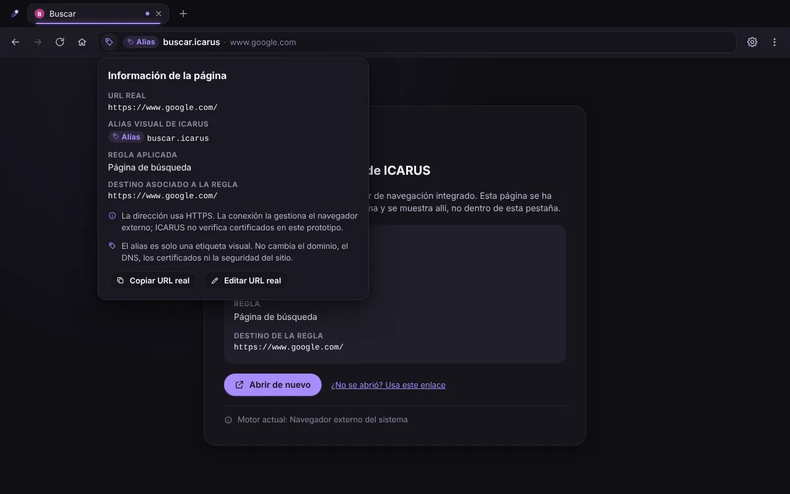
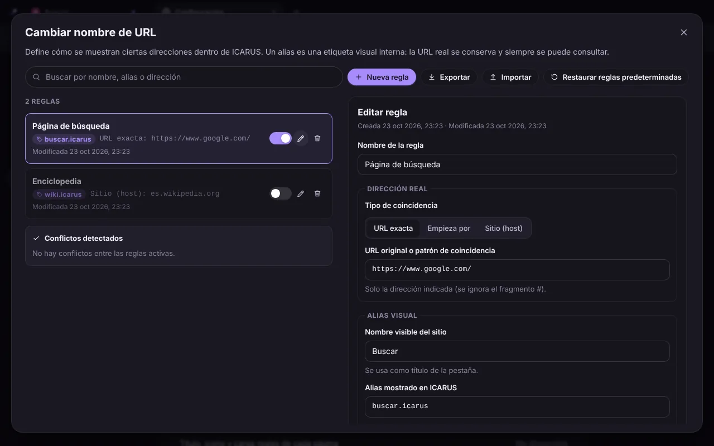

# ICARUS Browser

Navegador web de escritorio con identidad propia, interfaz personalizable, bloqueador de anuncios y rastreadores (ICARUS Shield) y un editor avanzado de alias de URL.

**Versión 0.2.0 (preliminar).** ICARUS es una aplicación de escritorio construida con **Electron 44 (Chromium 152)**: cada pestaña es una vista real de Chromium que carga las páginas dentro de la ventana de ICARUS. La prioridad es **Windows x64**, con instalador NSIS. La interfaz de la fase anterior (tres estilos, personalización, accesos directos, widgets, configuración y «Cambiar nombre de URL») se conserva completa y ahora controla el motor real.

El prototipo web (`dist/icarus-browser.html`) sigue existiendo, pero **no es un navegador ni un instalador**: es solo la interfaz, que entrega las páginas al navegador del sistema. Ver [Versión web](#versión-web-prototipo).

> ICARUS no está afiliado a Google ni a Microsoft. Los estilos «Esencial» y «Panorama» son diseños originales inspirados en patrones de navegadores conocidos; no usan logotipos ni recursos de esas marcas.

| ICARUS (estilo propio) | Esencial (inspirado en Chrome) | Panorama (inspirado en Edge) |
| --- | --- | --- |
|  |  |  |

| Alias en la barra con la URL real verificable | Editor «Cambiar nombre de URL» |
| --- | --- |
|  |  |

<sub>Capturas de la interfaz (página de nueva pestaña y editor de alias), comunes a la aplicación de escritorio y al prototipo web.</sub>


<sub>Aplicación de escritorio: una página local que pide scripts e imágenes a redes publicitarias y de analítica. El escudo muestra las 6 solicitudes que Chromium canceló de verdad.</sub>

---

## Índice

- [Estado de esta versión](#estado-de-esta-versión)
- [Instalar en Windows](#instalar-en-windows)
- [Compilar desde el código](#compilar-desde-el-código)
- [Funciones del navegador](#funciones-del-navegador)
- [Interfaz y personalización](#interfaz-y-personalización)
- [Versión web (prototipo)](#versión-web-prototipo)
- [Limitaciones conocidas](#limitaciones-conocidas)
- [Estructura del código](#estructura-del-código)
- [Datos y persistencia](#datos-y-persistencia)
- [Seguridad](#seguridad)
- [Pruebas](#pruebas)
- [Integración continua y publicación](#integración-continua-y-publicación)
- [Licencias de terceros](#licencias-de-terceros)
- [Próximos pasos](#próximos-pasos)

## Estado de esta versión

| Función | Estado |
| --- | --- |
| Páginas web dentro de las pestañas (Chromium) | **Real** |
| Pestañas: crear, cambiar, cerrar, reabrir, título, icono y carga reales | **Real** |
| Atrás, adelante, recargar, detener, páginas de error con el código de Chromium | **Real** |
| Barra de direcciones: URL, búsqueda (Google, Bing, DuckDuckGo), alias, páginas internas | **Real** |
| Alias de URL aplicados a la navegación real, sin cambiar la URL cargada | **Real** |
| ICARUS Shield: bloqueo de solicitudes con listas EasyList/EasyPrivacy y reglas propias | **Real** (solo bloqueo de red) |
| Descargas con progreso, cancelación, apertura y carpeta | **Real** |
| Historial persistente con búsqueda y borrado | **Real** |
| Permisos de sitios (cámara, micrófono, ubicación, notificaciones…) | **Real** |
| Autenticación HTTP (Basic, Digest, NTLM) | **Real** |
| Borrado de datos de navegación y borrado al salir | **Real** |
| Preferencias guardadas en la carpeta de datos del usuario | **Real** |
| Instalador de Windows (NSIS) y paquete portátil (.zip) | **Se genera** (ver [Instalar](#instalar-en-windows)) |
| Sesiones aisladas por pestaña | **No**: todas las pestañas comparten un perfil |
| Sincronización, cuentas, IA, marcadores, gestor de contraseñas | **No existen** (la interfaz no los muestra) |
| Actualizaciones automáticas, firma de código | **No** |
| Android, iPhone | **No**: el instalador es solo para Windows |

## Instalar en Windows

Requisitos: Windows 10 u 11 de 64 bits.

1. Descarga `ICARUS-Browser-Setup-0.2.0.exe`:
   - de un **borrador de versión** en la pestaña *Releases* del repositorio, si alguien con permisos lo ha creado y publicado, o
   - de **GitHub Actions** → flujo **Windows** → una ejecución en verde → artefacto **icarus-browser-windows-x64** (incluye el instalador, el `.zip` portátil y `SHA256SUMS.txt`).
2. Comprueba la suma SHA-256 con `Get-FileHash .\ICARUS-Browser-Setup-0.2.0.exe` y compárala con `SHA256SUMS.txt`.
3. Ejecuta el instalador. **No está firmado**, así que Windows SmartScreen mostrará «Windows protegió su PC»: pulsa *Más información* → *Ejecutar de todas formas* solo si descargaste el archivo de este repositorio.
4. El asistente permite elegir la carpeta (por defecto `%LOCALAPPDATA%\Programs\ICARUS Browser`, sin permisos de administrador) y crea accesos directos en el escritorio y el menú Inicio.

- **Actualizar**: ejecuta el instalador de la versión nueva; se instala encima y conserva tus datos.
- **Desinstalar**: Configuración de Windows → Aplicaciones, o `Uninstall ICARUS Browser.exe`. Tus datos (`%APPDATA%\ICARUS Browser`) **no se borran**; elimina esa carpeta a mano si quieres quitarlos.
- **Portátil**: descomprime `ICARUS-Browser-0.2.0-win-x64.zip` y ejecuta `ICARUS Browser.exe`. Usa la misma carpeta de datos que la versión instalada.

## Compilar desde el código

Requisitos: Node.js 20.19+ o 22.12+ y npm 10+.

```bash
npm install          # dependencias (Electron descarga Chromium la primera vez que se usa)
npm run dev          # interfaz con recarga en caliente + ventana de Electron
npm run build        # tipos (tsc -b), interfaz (Vite) y proceso principal (dist-electron/)
npm start            # abre la compilación de npm run build en Electron
npm run dist:win     # build + instalador NSIS y .zip x64 en release/
npm run dist:dir     # build + aplicación sin empaquetar para el sistema actual
```

Pruebas:

```bash
npm run test         # pruebas unitarias y de componentes (Vitest)
npm run test:e2e     # pruebas de extremo a extremo con Electron real (necesita npm run build)
npm run test:smoke   # prueba de humo del ejecutable empaquetado de release/
npm run typecheck    # solo tipos
```

Notas:

- `npm run dist:win` funciona en Windows. En Linux también genera el instalador si hay **Wine con soporte de 32 bits** (`wine`, `wine32`), que electron-builder necesita para crear el desinstalador NSIS; sin Wine solo se genera el `.zip`.
- En Linux, Chromium no admite su sandbox como **root**: ejecuta ICARUS y las pruebas con un usuario normal (nunca se usa `--no-sandbox`). Si el sistema restringe los espacios de nombres sin privilegios, `chrome-sandbox` debe pertenecer a root con permisos `4755`.
- Variables útiles: `ICARUS_USER_DATA_DIR` (otra carpeta de datos), `ICARUS_SHIELD_AUTO_UPDATE=0` (sin actualizar listas en segundo plano), `ICARUS_ENABLE_UI_DEVTOOLS=1` (herramientas de desarrollo de la interfaz en el ejecutable empaquetado).

## Funciones del navegador

### Pestañas y navegación
- Cada pestaña web es una `WebContentsView` de Chromium con su propio proceso de renderizador y sandbox. Al cerrarla se destruye la vista y se libera el proceso.
- Título, icono (favicon), URL y estado de carga reales. Las ventanas emergentes y los enlaces `target="_blank"` se abren como pestañas de ICARUS (los de clic central, en segundo plano).
- Atrás y adelante recorren primero el historial de Chromium y después las páginas internas de ICARUS de esa pestaña.
- Errores de red y de certificado con el código real de Chromium (`ERR_NAME_NOT_RESOLVED`, `ERR_CERT_…`), botones Reintentar y Atrás. **No se pueden omitir errores de certificado.**
- Menú contextual: abrir enlace en pestaña nueva, copiar enlace o imagen, guardar imagen, buscar el texto seleccionado, copiar, pegar, inspeccionar.
- Zoom por pestaña (Ctrl + / Ctrl − / Ctrl 0) y pantalla completa de vídeos.
- Los menús, el panel «Personalizar» y los diálogos se muestran sobre la página: mientras están abiertos, la página se sustituye por una captura.

### Atajos de teclado
Funcionan también con el foco dentro de una página web.

| Atajo | Acción |
| --- | --- |
| Ctrl + T / Ctrl + W | Nueva pestaña / cerrar pestaña |
| Ctrl + Mayús + T | Reabrir la última pestaña cerrada |
| Ctrl + L, Alt + D, F6 | Ir a la barra de direcciones (selecciona todo) |
| Ctrl + Tab / Ctrl + Mayús + Tab (o Ctrl + AvPág / RePág) | Pestaña siguiente / anterior |
| Alt + ← / Alt + → | Atrás / adelante |
| Ctrl + R, F5 / Ctrl + Mayús + R, Mayús + F5 | Recargar / recargar sin caché |
| Ctrl + H / Ctrl + J | Historial / descargas |
| F12, Ctrl + Mayús + I | Herramientas de desarrollo de la página |

### Barra de direcciones
- Distingue direcciones (`google.com`, `youtube.com`, `es.wikipedia.org`, `https://…`, `localhost:3000`, IP) de búsquedas, que van al proveedor elegido (Google, Bing o DuckDuckGo).
- Sugerencias de historial, accesos directos, reglas de alias y páginas internas, con lo que ocurrirá al pulsar Enter.
- Bloquea `javascript:`, `data:`, `file:`, `vbscript:`, `blob:` y protocolos desconocidos. Un enlace `mailto:` o `tel:` en una página no abre otras aplicaciones; se muestra un aviso.
- Páginas internas: `icarus://nueva-pestana`, `icarus://configuracion/<sección>`, `icarus://historial`, `icarus://descargas` e `icarus://en-blanco`.
- El icono de información muestra la **URL real**, el alias si lo hay y, en HTTPS, que Chromium aceptó el certificado.

### Alias de URL con navegación real
Los alias del editor «Cambiar nombre de URL» se aplican a la URL que informa Chromium tras cada navegación: la pestaña y la barra muestran el alias y el host real, pero la página se carga siempre desde su URL real y con su certificado. Si la página redirige o sigues un enlace fuera de la regla, el alias desaparece. Escribir un alias (`buscar.icarus`) abre el destino de su regla activa. No se crean dominios, registros DNS ni certificados falsos.

### ICARUS Shield
Bloquea solicitudes de anuncios y rastreadores antes de que salgan del equipo (scripts, imágenes, iframes, XHR…), con la lista básica incluida, **EasyList** y **EasyPrivacy** (descargadas y actualizadas cada 4 días), la lista de Peter Lowe opcional, listas propias por URL `https://` y reglas propias. El botón del escudo muestra cuántas solicitudes se bloquearon en la página actual y permite desactivar Shield en un sitio. No oculta elementos cosméticos ni bloquea la página principal. Detalles en [docs/SHIELD.md](docs/SHIELD.md).

### Descargas
Se guardan en la carpeta Descargas (o la elegida, o preguntando cada vez), con progreso, cancelación, «Mostrar en la carpeta» y «Abrir». Una descarga solo aparece como completada cuando Chromium lo confirma y el archivo existe. Los archivos ejecutables (`.exe`, `.msi`, `.bat`, `.ps1`…) nunca se abren desde ICARUS. Página `icarus://descargas` (Ctrl+J) y botón en la barra.

### Historial y privacidad
- `icarus://historial` (Ctrl+H): visitas agrupadas por día, búsqueda, eliminar entradas; máximo 10 000 visitas.
- Configuración → Privacidad: borrar historial, cookies y datos de sitios, caché y lista de descargas por periodo (última hora, día, semana o todo) y borrar automáticamente al salir.
- Permisos: cámara, micrófono, ubicación, notificaciones, lectura del portapapeles y MIDI se preguntan en una barra con el origen real; la decisión dura hasta cerrar ICARUS. Compartir pantalla y los dispositivos USB, HID, serie y Bluetooth se deniegan.
- Autenticación HTTP (Basic, Digest, NTLM): un diálogo de ICARUS pide usuario y contraseña con el origen real y el mensaje del sitio por separado, y avisa si la conexión no es HTTPS. ICARUS no guarda las credenciales; Chromium las recuerda en memoria hasta cerrar ICARUS o borrar las cookies.

## Interfaz y personalización

Todo lo de la fase anterior sigue funcionando igual en escritorio y en la versión web.

### Tres estilos con distribución propia
| Estilo | Inspiración | Distribución |
| --- | --- | --- |
| **Esencial** | Google Chrome | Columna centrada con logotipo minimalista, buscador en píldora, accesos circulares, mucho espacio en blanco; pestañas con esquinas curvas. |
| **Panorama** | Microsoft Edge | Imagen a pantalla completa, cabecera con marca y hora, buscador ancho, accesos en mosaico y zona de tarjetas configurable; pestañas rectangulares flotantes. |
| **ICARUS** | Propio | Carbón con resplandor morado animado, saludo y hora grandes, buscador de cristal, dock de accesos y columna lateral de tarjetas; variante clara «Marfil». |

El cambio es instantáneo. Cada estilo **guarda por separado** su modo de color, acento, fondo y distribución. En escritorio, la barra de título de Windows (botones minimizar, maximizar y cerrar) toma los colores del estilo.

### Personalización (botón «Personalizar» y Configuración → Apariencia)
- Modo **claro, oscuro o automático** (sigue al sistema).
- Color de acento (8 colores o el del estilo).
- Fondo: el del estilo, 8 colores, selector libre, 4 imágenes originales incluidas o **una imagen propia**.
- Distribución: posición del buscador, estilo de los accesos (círculos, mosaicos, dock), accesos por fila, densidad y posición de las tarjetas.
- Mostrar u ocultar accesos directos, tarjetas y cada widget; restablecer el estilo; «Reducir animaciones».

### Accesos directos y widgets
Accesos directos: añadir, editar, eliminar, reordenar, abrir en la pestaña actual o en una nueva, icono del sitio y restaurar los predeterminados. Widgets locales: reloj y fecha, calendario, notas y tareas. La tarjeta «Fuentes de contenido» está vacía a propósito: ICARUS no incluye un servicio de noticias.

### Configuración (`icarus://configuracion`)
- **General**: buscador, inicio (pestaña nueva o restaurar pestañas), página principal, estilo, idioma y restaurar valores.
- **Apariencia**: todos los controles de personalización.
- **Navegación**: nueva pestaña, dónde abrir los accesos, iconos de sitios y gestor de accesos directos.
- **Privacidad**, **ICARUS Shield** y **Descargas** (solo en escritorio).
- **Avanzado**: alias en la interfaz, botón discreto **«Cambiar nombre de URL»**, exportar e importar la configuración en JSON, estado real del motor y carpeta de datos.
- **Acerca de ICARUS**: versión, motor, plataformas y atajos.

### «Cambiar nombre de URL» (Configuración → Avanzado)
No aparece en la página de inicio ni en la barra principal. Panel completo para reglas de alias visual: tipo de coincidencia (URL exacta, prefijo o host con comodín `*.dominio`), URL original o patrón, nombre visible, alias `.icarus`, URL de destino real, estado y fechas. Crear, editar, cancelar con aviso, eliminar con confirmación, activar/desactivar, buscar, vista previa, probador de URL, restaurar ejemplos, exportar e importar, detección de conflictos y prioridad determinista (exacta > prefijo más largo > host concreto > comodín; en empate, la más antigua).

## Versión web (prototipo)

`npm run build:single` genera `dist/icarus-browser.html`, la interfaz en un único archivo que se abre con doble clic en Chrome, Edge o Firefox. **No es el navegador ni su instalador**: no tiene motor propio, Shield, descargas ni historial; cada página web se abre en el navegador del sistema y la pestaña de ICARUS lo indica. Sirve para probar la interfaz sin instalar nada. También puede servirse `dist/` (tras `npm run build:web`) desde cualquier alojamiento estático. En esta versión las preferencias se guardan en el LocalStorage de ese navegador.

Si el alojamiento bloquea ventanas emergentes: `VITE_ICARUS_EXTERNAL_OPENING=confirm npm run build:web`.

## Limitaciones conocidas

- **Un solo perfil**: todas las pestañas comparten cookies, almacenamiento y caché. Iniciar sesión en una pestaña inicia sesión en todas. Cada pestaña tiene su propio proceso con sandbox, pero eso no aísla los datos.
- **Sin firma de código**: SmartScreen avisa al instalar. Sin actualizaciones automáticas.
- **Shield** solo bloquea solicitudes de red: no oculta elementos, y no bloquea anuncios servidos desde el mismo dominio que el contenido (p. ej. YouTube).
- **Sin Widevine** (DRM): Netflix, Disney+ y similares no reproducen vídeo.
- **Inicio de sesión de Google** y otros proveedores pueden rechazar navegadores integrados que no reconocen.
- **Compartir pantalla** no disponible (se deniega) y no hay selector de dispositivos USB, HID, serie ni Bluetooth.
- **Idioma**: la interfaz está en español; los textos están centralizados en `src/i18n/es.ts` y los menús del proceso principal en `electron/main/strings.ts`.
- **Plataformas**: el instalador es solo para Windows x64. El código funciona en Linux (las pruebas E2E se ejecutan allí) y debería funcionar en macOS, pero no se publican instaladores. Android e iPhone necesitarán aplicaciones propias.

## Estructura del código

```
icarus-browser/
├── electron/                    Proceso principal y preload (TypeScript → dist-electron/)
│   ├── main/
│   │   ├── main.ts              Arranque, sesiones, seguridad global, salida
│   │   ├── window.ts            Ventana, barra de título, estado de la ventana
│   │   ├── uiProtocol.ts        Protocolo icarus-app:// con CSP para la interfaz
│   │   ├── tabs.ts              TabManager: una WebContentsView por pestaña, eventos, atajos, errores
│   │   ├── ipc.ts · validate.ts Canales IPC y validación de remitente y argumentos
│   │   ├── shieldService.ts     Listas, actualización, excepciones y webRequest de Shield
│   │   ├── downloads.ts · history.ts · permissions.ts · favicons.ts · preferences.ts
│   │   ├── uiStorage.ts · jsonFile.ts  Almacenamiento de la interfaz y archivos JSON atómicos
│   │   ├── urlPolicy.ts         Protocolos permitidos, archivos peligrosos, nombres seguros
│   │   └── contextMenu.ts · strings.ts
│   ├── preload/ui.ts            Expone window.icarusNative (solo a la interfaz)
│   └── shield/                  Analizador de filtros, motor de coincidencias, dominios, lista básica
├── src/                         Interfaz React (compartida por escritorio y web)
│   ├── types/native.ts          Contrato IPC entre interfaz y proceso principal
│   ├── services/navigation/     BrowserEngine: nativeEngine.ts (Chromium) y motor externo (web)
│   ├── services/persistence/    Documentos versionados, migraciones, nativeStorage.ts
│   ├── components/BrowserShell/ Ventana, controlador de pestañas, WebArea, Shield, descargas, avisos
│   ├── components/InternalPages/ Historial, descargas, página externa (web), en blanco
│   ├── components/Settings/     Secciones, incluidas Privacidad, ICARUS Shield y Descargas
│   └── …                        Barra de direcciones, temas, accesos, widgets, alias, i18n
├── tests/e2e/                   run.mjs (Playwright + Electron) y smoke-packaged.mjs
├── scripts/                     dev.mjs, electron-postbuild.mjs, build-single-file.mjs
├── build/                       Iconos del ejecutable y del instalador
├── electron-builder.yml         Empaquetado (NSIS, zip, fusibles de Electron)
└── docs/                        ARCHITECTURE, ENGINE_INTEGRATION, SHIELD, SECURITY
```

Más detalle en [docs/ARCHITECTURE.md](docs/ARCHITECTURE.md) y [docs/ENGINE_INTEGRATION.md](docs/ENGINE_INTEGRATION.md).

## Datos y persistencia

En escritorio todo se guarda en `%APPDATA%\ICARUS Browser` (Windows):

| Archivo | Contenido |
| --- | --- |
| `ui-storage.json` | Preferencias, accesos directos, reglas de alias, widgets, fondo y pestañas (claves `icarus.*`) |
| `preferences.json` | Descargas y privacidad |
| `history.json` · `downloads.json` | Historial y lista de descargas |
| `shield/` | Configuración y listas de Shield |
| `window-state.json` | Tamaño y posición de la ventana |
| `Partitions/icarus-web/` | Cookies, caché y almacenamiento de los sitios (Chromium) |

Cada archivo se escribe de forma atómica con un sobre versionado `{ version, savedAt, data }` y se sanea campo a campo al leerlo; uno dañado se guarda como `.corrupt-<fecha>` antes de usar los valores predeterminados. Al primer arranque, los datos de una versión preliminar que usara LocalStorage se migran una vez a `ui-storage.json`. Actualizar o desinstalar no borra la carpeta. Nunca se guardan contraseñas ni secretos.

## Seguridad

Resumen (completo en [docs/SECURITY.md](docs/SECURITY.md)):

- Páginas web con `sandbox`, `contextIsolation`, sin Node ni preload; la interfaz en `icarus-app://` con CSP estricta y un preload mínimo; IPC con validación de remitente y argumentos.
- Solo `http:` y `https:`; TLS verificado por Chromium sin posibilidad de omitir errores; sin ventanas nuevas de Electron; sin `<webview>`.
- Permisos preguntados al usuario o denegados; ejecutables descargados nunca se abren desde ICARUS.
- Fusibles de Electron: sin `ELECTRON_RUN_AS_NODE`, `NODE_OPTIONS` ni `--inspect`, integridad de `app.asar`, cookies cifradas.
- El ejecutable no contiene claves ni credenciales.
- Los alias viven en el espacio `.icarus`, no pueden degradar HTTPS a HTTP y el host real siempre se muestra.

## Pruebas

| Conjunto | Qué comprueba | Linux (local y CI) | Windows (GitHub Actions, `windows-latest`) |
| --- | --- | --- | --- |
| `npm run test` (115 pruebas, 13 archivos) | Servicios, componentes, filtros de Shield, dominios, rutas seguras, archivos JSON | 115/115 | 115/115 |
| `npm run test:e2e` (24 pasos + 3 sitios reales) | Ver abajo | 24/24 en local (Xvfb, sin acceso a esos sitios) · en CI, ver la última ejecución | Ver la última ejecución del flujo Windows |
| `npm run test:smoke` | Ejecutable empaquetado: arranque, página dentro de la pestaña, sin puente nativo en la web, datos en disco | Superada | Superada (sin instalar y ya instalado) |
| Instalación silenciosa | `Setup.exe /S`, prueba de humo del navegador instalado y desinstalación silenciosa | — | Superada |

Pasos E2E con Electron real y servidores HTTP y HTTPS locales: 1 iniciar · 2 abrir una página dentro de la pestaña · 3 buscar desde la barra · 4 volver atrás · 5 dos pestañas y cambiar · 6 atrás y adelante · 7 recargar · 8 `target=_blank` como pestaña · 9 cerrar y crear pestañas libera vistas · 10 los tres estilos · 11 menús sobre la página · 12 alias con navegación real y URL real conservada · 13 Shield bloquea una solicitud real y el contador lo refleja · 14 descarga real a disco · 15 historial · 16 icono real del sitio y detener la carga · 17 Ctrl+L desde la página (selecciona toda la dirección), Ctrl+W, Ctrl+Mayús+T y Ctrl+Tab · 18 el alias se retira cuando la regla deja de coincidir · 19 `javascript:`, `mailto:` y `file:` bloqueados en la barra y en enlaces · 20 certificado autofirmado rechazado sin opción de omitirlo (necesita `openssl`; si falta, el paso se marca como omitido) · 21 permiso de ubicación preguntado con el origen real y denegado · 22 autenticación HTTP: cancelar (401), contraseña incorrecta (se vuelve a pedir) y correcta, con la página oculta bajo el diálogo · 23 cerrar, reabrir y conservar estilo, reglas de Shield, historial y alias · 24 borrar el historial.

`ICARUS_E2E_INTERNET=1` añade sitios reales por HTTPS (Wikipedia, Google y YouTube por defecto, o `ICARUS_E2E_SITES`): comprueba que cargan sin página de error y que la URL final es `https://`. Los flujos de GitHub Actions lo activan en Linux y en Windows. En el entorno donde se desarrolló esta versión, la red solo permitía algunos dominios: **github.com cargó dentro de ICARUS con TLS verificado**, mientras que Wikipedia, Google, YouTube y easylist.to estaban bloqueados por el proxy del entorno (`CONNECT 403`), así que esas páginas y la descarga de EasyList no pudieron probarse allí. En GitHub Actions, sin esas restricciones, el paso 3 sí cargó la búsqueda real de Google. No hubo una máquina Windows física: las pruebas de Windows son las de los ejecutores de GitHub Actions.

La prueba de humo habla directamente el protocolo DevTools, porque el ejecutable empaquetado tiene desactivado `--inspect`. En Windows, Playwright se quedaba esperando a veces si se conectaba mientras Electron creaba la ventana; por eso las pruebas E2E usan `ICARUS_STARTUP_DELAY_MS=2000`, que retrasa la ventana dos segundos solo en la versión sin empaquetar.

## Integración continua y publicación

- **CI** (`.github/workflows/ci.yml`, Ubuntu): tipos, pruebas, compilación, HTML autocontenido, pruebas E2E con Xvfb, empaquetado de Linux y prueba de humo.
- **Windows** (`.github/workflows/windows.yml`, `windows-latest`): tipos, pruebas, compilación, instalador NSIS y `.zip`, sumas SHA-256, prueba de humo del ejecutable, instalación y desinstalación silenciosas, pruebas E2E y artefacto `icarus-browser-windows-x64` (30 días).
- **Versiones**: al subir una etiqueta `v*` o lanzar el flujo a mano con *draft_release*, se crea un **borrador** de versión preliminar con el instalador. Nunca se publica una versión estable automáticamente: alguien debe revisarla y publicarla.

## Licencias de terceros

- **Electron y Chromium**: el paquete incluye sus licencias (`LICENSE.electron.txt` y `LICENSES.chromium.html` junto al ejecutable).
- **Public Suffix List**: incluida en el ejecutable para ICARUS Shield; Mozilla Public License 2.0 (`electron/shield/publicSuffixList.ts` indica la fuente y la versión).
- **EasyList, EasyPrivacy y la lista de Peter Lowe**: no se incluyen en el instalador; ICARUS las descarga de sus fuentes oficiales y se usan según sus propias licencias.

## Próximos pasos

1. Firma de código del instalador y actualizaciones automáticas (electron-updater; el `.blockmap` ya se genera).
2. Perfiles aislados (una partición `persist:<perfil>` por perfil) y ventanas por perfil.
3. Shield: filtros cosméticos (ocultar elementos) y actualización de la Public Suffix List en cada versión.
4. Selector de pantalla para compartir y selector de dispositivos.
5. Traducciones (la interfaz ya usa un catálogo de textos).
6. Sincronización y cuentas con un servicio propio (p. ej. FastAPI + PostgreSQL) y cifrado, sin claves dentro del ejecutable.
7. Aplicaciones para Android (WebView o GeckoView) e iPhone (WKWebView) reutilizando esquemas y reglas.
